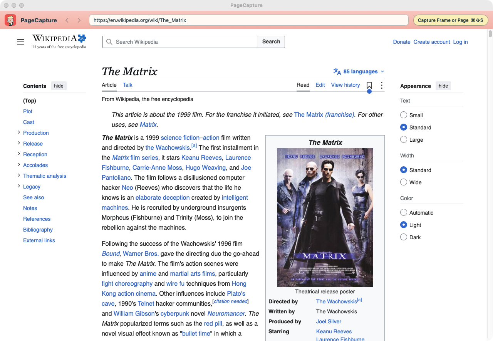
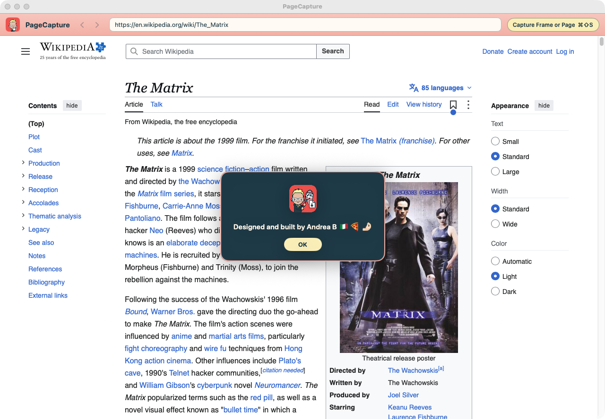
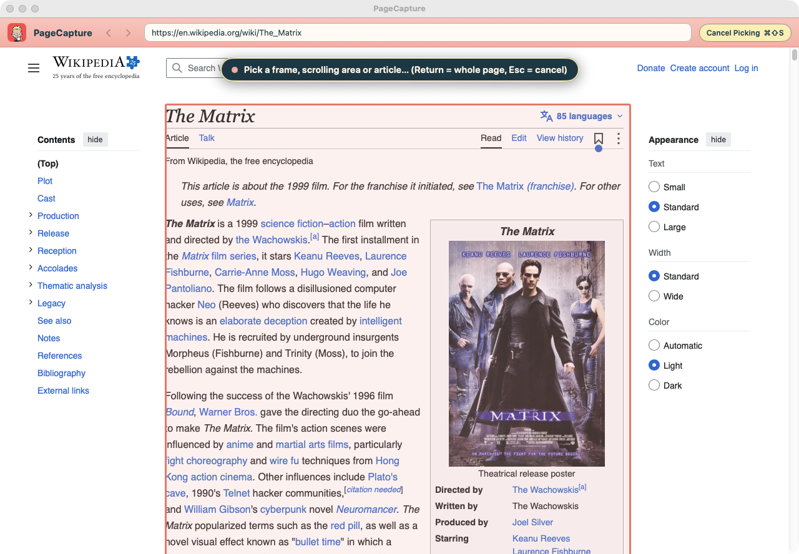
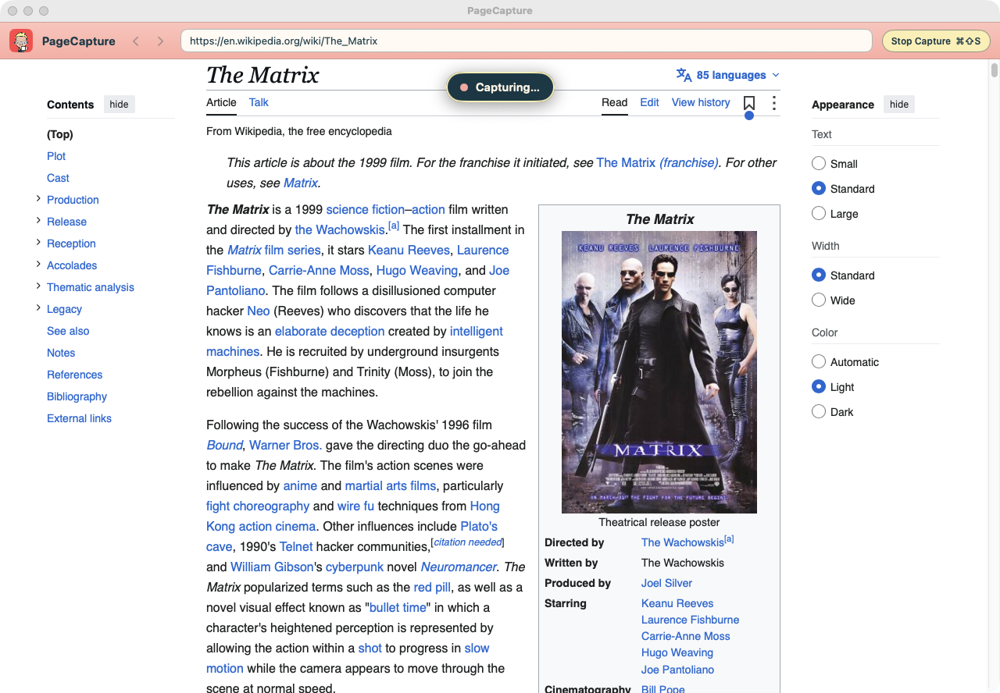
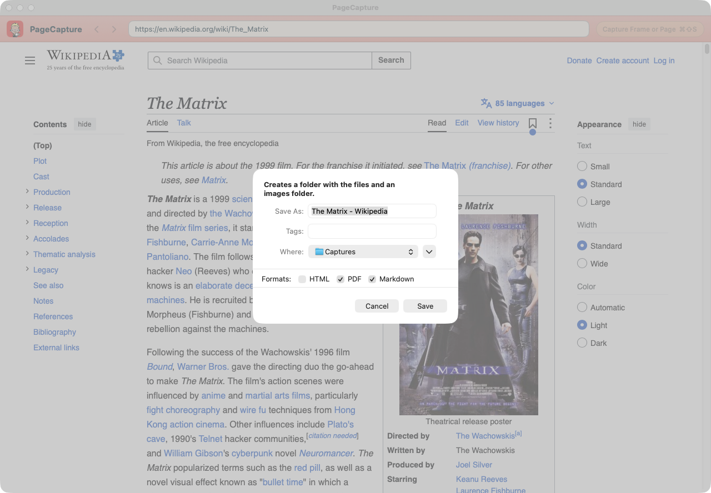
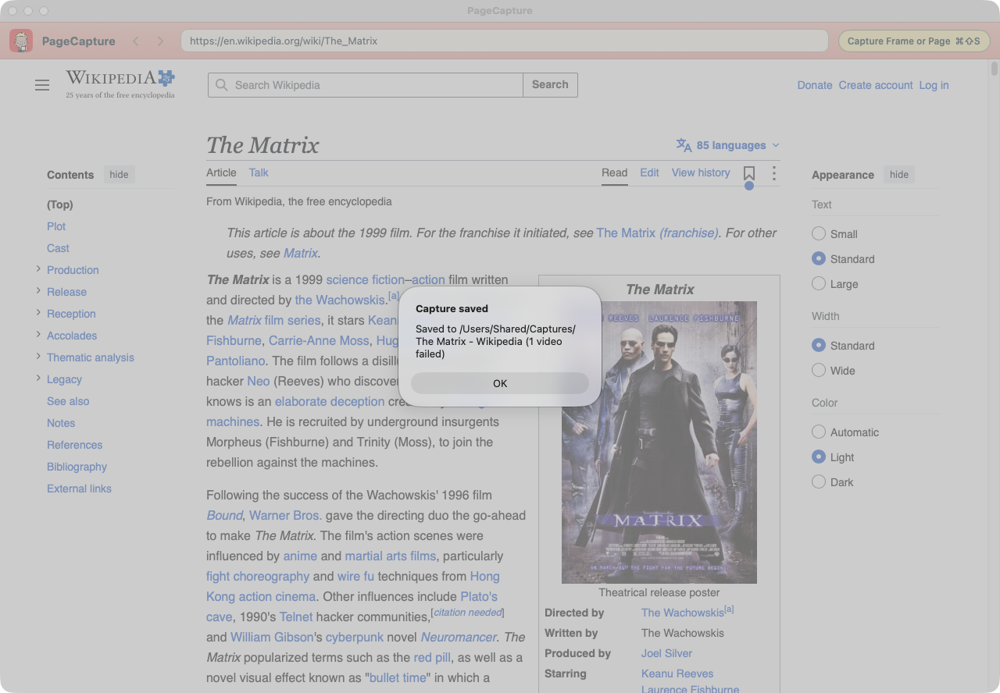

# PageCapture

Capture a long webpage, or just one part of it, and save it as HTML, PDF and Markdown, with its
images and videos. A macOS app with its own built-in browser.



## Install

**Requirements:** a Mac with Apple silicon (M1 or later) and macOS 14 or later. No special
permissions (Screen Recording, Accessibility…) are needed.

1. Download `PageCapture.dmg` from the [latest release](https://github.com/AndreaB321/PageCapture/releases/latest).
   You only need the DMG: the `PageCapture-third-party-sources` archive next to it is the source
   code of the bundled tools, provided for licence compliance, and is not needed to install.
2. Open it and drag **PageCapture** onto the **Applications** folder next to it. Then eject the
   PageCapture disk in the Finder sidebar.
3. PageCapture is not signed with an Apple Developer ID, so macOS blocks it the first time.
   Choose **one** of these:

   **A. From System Settings** (macOS 15 Sequoia and later)
   1. Open PageCapture from Applications. macOS says it cannot verify the developer: click **Done**
      (not *Move to Bin*).
   2. Open **System Settings → Privacy & Security**, scroll down to the message about PageCapture
      and click **Open Anyway**. Confirm with your password or Touch ID.

   On macOS 14, right-click PageCapture in Applications → **Open**, then **Open** again.

   **B. From Terminal** (recommended if you will save videos)

   ```bash
   xattr -dr com.apple.quarantine /Applications/PageCapture.app
   ```

   This removes the "downloaded from the internet" mark from the app *and* from the tools inside
   it (ffmpeg, yt-dlp, Deno) that save videos. With option A, macOS may still block those tools the
   first time they run, and video downloads would fail.

To **update**, quit PageCapture, drag the new version onto Applications, choose **Replace**, and
repeat step 3.

## Contents

1. [The window](#the-window)
2. [Capture a page](#capture-a-page)
3. [Save](#save)
4. [The three formats](#the-three-formats)
5. [Reading Markdown on a Mac](#reading-markdown-on-a-mac)
6. [Images and videos](#images-and-videos)
7. [Signed-in sites](#signed-in-sites)
8. [Keyboard shortcuts](#keyboard-shortcuts)
9. [Tips and limits](#tips-and-limits)
10. [Build from source](#build-from-source)

The same manual is inside the app: **Help → PageCapture Manual** (⌘?).

## The window

PageCapture is a small browser of its own: everything you capture is opened here. From left to
right, the header bar has:

- **Back and forward** arrows (also ⌘[ and ⌘]). They fade when there is no page to go to.
- The **address field**. Type or paste a web address and press Return.
- The yellow **capture button**, which does the same as ⌘⇧S and shows what it will do next
  (capture, cancel, stop).



At launch a short credit appears. Click OK, or wait five seconds.

## Capture a page

One shortcut does everything: **⌘⇧S**.

### Pick what to capture

Press ⌘⇧S. A banner at the top says the app is waiting for you to pick. Move the mouse over the
page: the part under the pointer is outlined. You can pick:

- a **frame** (a page embedded in the page, such as a document viewer),
- a **scrolling area** (a panel that scrolls on its own),
- the page's **main article**, on sites that mark it, such as Wikipedia and most documentation
  sites. Side columns, toolbars and menus inside it are left out,
- the **whole page**: click outside any outlined area, or press Return.

Press Esc, or ⌘⇧S again, to cancel.



### Let it scroll

Click to start. The banner changes to **Capturing…** and the app scrolls from top to bottom by
itself, collecting the content in order as it loads. Along the way it:

- waits for images and lists that only load when you scroll to them,
- opens collapsed sections, accordions and every tab, so their content is saved too,
- plays each video briefly, with the sound off, to find its file, then pauses it,
- keeps content that the page removes again as you scroll past it.

The capture ends by itself at the bottom. To stop early and keep what has been collected so far,
press ⌘⇧S again.



Keep the window visible while it captures: macOS slows down hidden windows.

## Save

When the capture ends, a Finder save panel opens. Name the capture, choose where to put it, and
tick the formats you want: **HTML**, **PDF**, **Markdown**, in any combination. PageCapture
remembers your ticks for next time, and at least one box always stays ticked.



Saving creates one folder with everything inside:

```
Name/
  Name.html
  Name.pdf
  Name.md
  images/   the page's images
  videos/   the page's videos, when there are any
```



When it is done, a **Capture saved** message says where the capture is, and counts any images or
videos that could not be saved.

## The three formats

- **HTML**: one self-contained file that looks like the page on screen, with the site's own
  styles, fonts and images inside it. It opens in any browser, offline, at any window width.
  Menus, sidebars and footers are left out, and every tab and collapsed section is shown open,
  under its title.
- **PDF**: the page laid out on A4 or Letter (from your Mac's region), with text at 10 pt. Text
  can be selected and links clicked. Pictures, boxes and lines are not cut across pages, and every
  tab is printed in turn, under its title.
- **Markdown**: the content as plain, structured text: headings, paragraphs, lists, tables, links
  and images. Menus, buttons and player controls are left out. It is the most useful format to
  keep, search, edit or give to other tools.

## Reading Markdown on a Mac

Markdown is the best way to keep what you capture. It is plain text, so any app can open it today
and in twenty years. It is small, easy to search and edit, and it is what note apps and AI tools
read best. Its images stay as normal files in the `images/` folder beside it.

macOS has no built-in Markdown reader, though. TextEdit shows the raw text with its symbols (`#`,
`**`, ``) instead of formatted headings and pictures. Install one of these free readers, which
are still being updated:

| Reader | What it is |
| --- | --- |
| [Readdown](https://readdown.app) | A read-only reader: it opens `.md` files formatted and never changes them. It also previews them in the Finder when you press Space. Free, macOS 13 or later. |
| [Imark](https://imarkmd.com) | A reader first, with an optional edit mode for quick fixes. Free and open source, macOS 14 or later. |
| [MarkViewer](https://markviewer.com/markdown-preview-mac) | A native viewer that can also edit in place. Free, macOS 10.15 or later. |

To always open `.md` files in your reader: in the Finder, select a `.md` file, press ⌘I, choose
the app under **Open with**, then click **Change All…**.

## Images and videos

### Images

Every picture in the captured part is saved in `images/`, numbered in page order. Images in newer
formats that not every app can show (AVIF, WebP, HEIC, JPEG XL) are saved as PNG.

### Videos

Videos are saved in `videos/` as MP4:

- video files and streamed videos are downloaded with your browser sign-in,
- YouTube and Vimeo videos embedded in the page are downloaded with the bundled *yt-dlp* tool.

In all three formats each video appears as its preview picture with a ▶ play button, linking to
the saved file. A video that cannot be saved links to the original instead, with a short note
saying why.

Copy-protected videos (DRM) are never downloaded: they are linked to the original. Only save
videos you are allowed to keep.

YouTube changes often. If YouTube videos stop downloading, choose **PageCapture → Update Download
Tools**.

## Signed-in sites

To capture a page that needs an account, sign in inside PageCapture's own window, just as in any
browser. PageCapture keeps that sign-in for next time. It does not use the sign-ins of Safari or
Chrome.

When saving videos from YouTube or Vimeo, only that site's own cookies are passed to the download
tool, in a private temporary file that is deleted straight away. Nothing temporary is written into
your capture folder.

## Keyboard shortcuts

| Shortcut | What it does |
| --- | --- |
| ⌘⇧S | Start picking · cancel picking · stop capturing and keep what was collected |
| Return | While picking: capture the whole page |
| Esc | While picking: cancel |
| ⌘[ / ⌘] | Back / forward |
| ⌘? | Open the manual |

## Tips and limits

- Keep the PageCapture window visible while it captures: macOS slows down hidden windows.
- Pick the article, not the whole page, when you only want the content: the result is cleaner in
  every format.
- The PDF links to saved videos with their full location on your Mac, so they stop working if you
  move the capture folder. The HTML and Markdown links keep working because they are relative.
- A tab or section that takes a long time to load its content after a click may be saved empty.
- Very wide tables or code blocks are cut at the right margin of the PDF.
- Pop-up windows for signing in and links that open a new window are not supported yet.
- Quitting during a save stops the download tools and cleans up first.

## Build from source

Requires Xcode (Swift 6) on an Apple silicon Mac.

```bash
swift build
scripts/fetch-tools.sh   # builds ffmpeg/ffprobe from source and fetches yt-dlp and Deno into build/tools
swift test
scripts/make-dmg.sh      # build/PageCapture.app and build/PageCapture.dmg
```

`SPEC.md` describes the behaviour in detail.

The manual (Help → PageCapture Manual) is `docs/manual/index.html`, bundled into the app's
`Resources/Manual`. Its screenshots in `docs/manual/images` come from the real UI:

```bash
swift run ManualShots
```

It opens its own window on the Wikipedia article on The Matrix (non-persistent web data, its own
defaults), drives the capture flow, saves into `/Users/Shared/Captures` and deletes it, and quits.
It needs Screen Recording permission for the app it runs from (the terminal).

### Bundled tools and licences

PageCapture's own code is under the MIT licence ([LICENSE](LICENSE)). To save videos, the app
bundles ffmpeg and ffprobe (built from source by `scripts/fetch-tools.sh`, LGPL 2.1+), yt-dlp (the
official `yt-dlp_macos` executable, GPLv3+ as a whole) and Deno (MIT) in
`PageCapture.app/Contents/Helpers/`. [THIRD_PARTY_NOTICES.md](THIRD_PARTY_NOTICES.md) lists each
one with its version, licence, what it contains and where its source is. The app carries that file
and the licence texts in `Contents/Resources/ThirdPartyNotices/`.

PageCapture uses code of [FFmpeg](https://ffmpeg.org) licensed under the
[LGPLv2.1](https://www.gnu.org/licenses/old-licenses/lgpl-2.1.html). The corresponding source of
the bundled tools (the FFmpeg source and its build recipe, and the yt-dlp source) is attached to
each [GitHub release](../../releases) as `PageCapture-third-party-sources-<version>.tar`, next to the
DMG. `scripts/make-source-bundle.sh` builds it.
